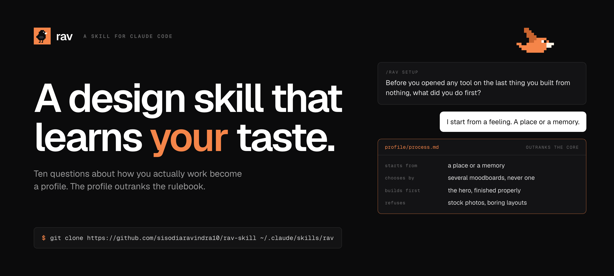
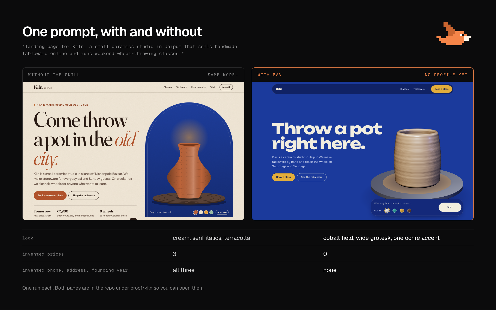
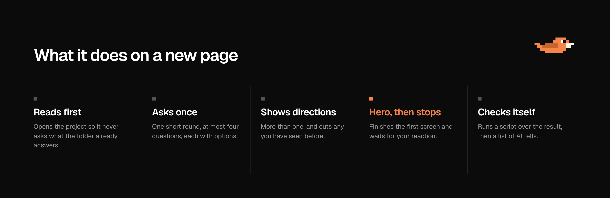
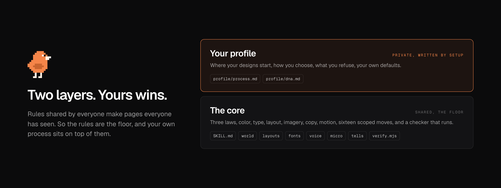

<p align="center">
  
</p>

# rav 

**A design skill for Claude Code that learns your taste.**

Most design skills are a rulebook: the same rules for everyone, so the same pages for everyone. rav has the rulebook too, but it also interviews you. Ten questions about how you actually work become a profile, and the profile outranks the rules.

## One prompt, with and without

<p align="center">
  
</p>

Same prompt, same model, one run each. The plain run landed on cream, serif italics and terracotta, the look models reach for whenever the subject is a craft, and it invented three prices, a phone number, a street address and a founding year. The run with rav did neither. Both pages, the prompt and the full comparison are in [`proof/kiln`](proof/kiln).

Both pages are competent. This shows a narrow, checkable difference, not a verdict. See [What is not proven](#what-is-not-proven).

## Install

```bash
git clone https://github.com/sisodiaravindra10/rav-skill ~/.claude/skills/rav
```

Then, in Claude Code:

```
/rav setup
```

That is the interview. About ten questions, one at a time, rough answers are fine. It writes your profile into `~/.claude/skills/rav/profile/`, which git ignores, so it stays on your machine and survives updates.

You can skip setup and use the skill straight away. It works from the core rules and gets sharper once it knows you.

## Use

Ask for design work the way you normally would:

```
build me a landing page for a ceramics studio in Jaipur
/rav critique this page
/rav polish the pricing section
/rav bolder the hero
```

<p align="center">
  
</p>

On a new page it will:

1. **Read the project first,** so it never asks what the folder already answers.
2. **Ask one short round of questions,** at most four, each with options: what a visitor should do, who it is for, which first-screen direction is closest, what real material exists.
3. **Show more than one direction,** and cut any that look like something you have seen before.
4. **Build the hero first, finish it, and stop** to show you, before building anything underneath.
5. **Run its own checker** on the result and filter it against a list of things that mark a page as AI-made.

If you say "just build it", it skips the questions and tells you what it assumed.

## What is in it

<p align="center">
  
</p>

**Your profile** (`profile/`, created by setup)

- `process.md`: where your designs start, how you choose between directions, what you refuse, what you check.
- `dna.md`: your own defaults (faces, colors, voice rules), applied only to your own work.

**The core** (`SKILL.md` and `reference/`)

| File | What it carries |
|---|---|
| `SKILL.md` | The decision spine: three laws, registers, color, type, layout, imagery, copy, motion, sixteen scoped moves |
| `reference/setup.md` | The profile interview |
| `reference/intake.md` | Read first, then one round of questions |
| `reference/world.md` | Deriving a visual world from the audience's culture, not from the category |
| `reference/layouts.md` | Hero and section recipes read off shipped pages, with what kills each one |
| `reference/fonts.md` | A roster of Google Fonts sorted by job, every name checked to load, with pairings |
| `reference/voice.md` | Eighteen sentence shapes that mark copy as machine-written, and the pass that removes them |
| `reference/micro.md` | The control-scale floor: press, hover, popovers, tooltips, surface details |
| `reference/tells.md` | The production-tell list, run as the last filter |
| `reference/craft-floor.md` | Contrast, spacing, states, browser surfaces, performance, accessibility |
| `reference/moves.md` | Playbooks for polish, bolder, quieter, distill, harden and eleven more |
| `reference/modes.md` | Build, generate and critique, step by step |
| `reference/redesign.md` | Refinement versus redesign |
| `reference/mobile-aesthetics.md` | Seven lanes for consumer mobile apps |

**The checker** (`scripts/verify.mjs`)

Rules a model reads get broken. Rules a script runs do not. The mechanical half of the craft floor is executable:

```bash
node ~/.claude/skills/rav/scripts/verify.mjs --source src/      # static scan, exit 2 on findings
node ~/.claude/skills/rav/scripts/verify.mjs --emit-browser     # prints a probe to run in the page
```

It catches em dashes, slop phrases, scroll listeners, entrances from `scale(0)`, `ease-in`, enumerated section labels, low-alpha text, and in the browser: measured contrast (including OKLCH), touch targets, unreachable scroll areas, and content that only exists once a script runs.

**An example profile** (`examples/ravindra/`)

The real profile of the designer who made this: he starts from a place or a memory, builds several moodboards, finishes the hero before anything else, and judges it by stepping away and coming back. Read it to see what a finished profile looks like. Yours will say different things, which is the point.

## How it decides

Three laws outrank everything else in the file:

1. **The brief wins.** A pinned font, palette or reference beats every default.
2. **Refinement preserves, redesign replaces.** It never smuggles a redesign into a polish.
3. **Visual authority is evidence.** A project that already has an identity keeps it.

And one idea runs under all of it: **the rules are a floor, not an idea.** A page can pass every rule and still be timid. So before any rule is applied, the work has to state one idea a stranger would repeat, and each screen has to have one dominant thing.

## Works alone, better with company

Every other skill rav mentions is optional. If one is installed it hands that part over; if not, it does the work itself.

| Part | Skill | From |
|---|---|---|
| Motion judgment, library picks | `animate`, `apple-design`, `choreograph`, `gestures`, `review-animations`, `pick-ui-library` | [emilkowalski/skills](https://github.com/emilkowalski/skills) |
| Detail review | `make-interfaces-feel-better` | [jakubkrehel/make-interfaces-feel-better](https://github.com/jakubkrehel/make-interfaces-feel-better) |
| Award-level builds | `awwwards`, `jury` | [juliobsz/skills](https://github.com/juliobsz/skills) |
| Rewriting machine-sounding copy | `humanizer` | [blader/humanizer](https://github.com/blader/humanizer) |
| Marketing copy | `copywriting`, `cro` | [coreyhaines31/marketingskills](https://github.com/coreyhaines31/marketingskills) |
| Brand systems as reference | design-md library | [VoltAgent/awesome-design-md](https://github.com/VoltAgent/awesome-design-md) |

## Credits

The core stands on other people's work. Rules were distilled, rewritten and in places rejected, but the debt is real:

- [impeccable](https://github.com/pbakaus/impeccable) by Paul Bakaus: visitor modes, world derivation, the move verbs, the craft floor.
- [taste-skill](https://github.com/Leonxlnx/taste-skill) by Leonxlnx: the design read, dial inference, the production-tell list.
- [emilkowalski/skills](https://github.com/emilkowalski/skills) by Emil Kowalski: the micro-interaction floor.
- [make-interfaces-feel-better](https://github.com/jakubkrehel/make-interfaces-feel-better) by Jakub Krehel: the surface details.
- [humanizer](https://github.com/blader/humanizer) by blader, and Wikipedia's "Signs of AI writing": the shape of the voice pass.

## What is not proven

Stated plainly, because a design skill is easy to oversell:

- The comparison at the top is one pair of runs, not a benchmark. Models vary from run to run and a single pair can flatter either side.
- A second pair was run and thrown away. Its prompt turned out to be the same one this skill used as a worked example in its own instructions, so the skill had the answer in advance. That example has since been replaced. If a skill's demo looks too good, check whether the demo is in the skill.
- In an earlier test between two versions of this skill, the newer one was visibly better on one brief out of three and indistinguishable on the other two.
- The profile is the part most likely to matter and the part least tested, because it only shows its value over weeks of real use.

If you run your own comparison, open an issue with the result either way.

## The raven


"rav" is one letter short of raven, a bird that collects things and remembers faces. That seemed right for a skill whose job is to remember how you work. The sprites are in [`assets/mascot`](assets/mascot), drawn on a 16 by 16 grid.

<br clear="left">

## Contributing

Issues and pull requests are welcome, especially: a tell the list misses, a rule that made your output worse, a checker false positive, or your own profile for `examples/` if you are happy to share one.

## License

MIT. See `LICENSE`.
